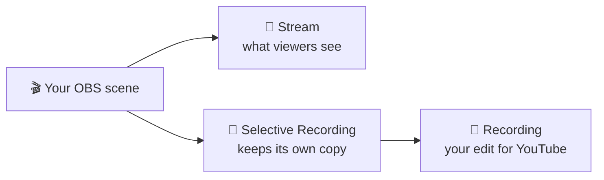
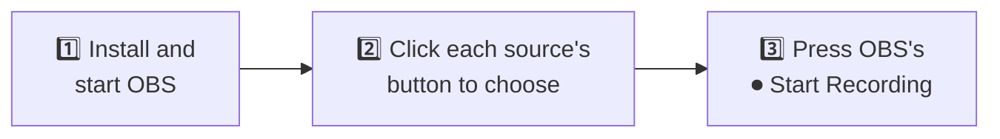
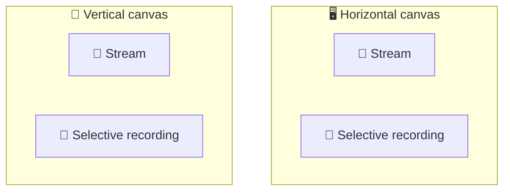

# OBS Selective Recording

**Record something different from what you stream, just like Streamlabs, in OBS Studio.**

Keep alerts and chat off your YouTube upload. Keep a facecam or "BRB" screen in the recording but off stream. Every source in OBS gets a button, and one click decides where it goes.

## The buttons

Every source in OBS's **Sources** list (and in Aitum Vertical's) gets a button next to its eye 👁 icon. Click it to cycle through:

| | Setting | On stream | In recording | Good for |
| :---: | --- | :---: | :---: | --- |
|  | **Stream and recording** | ✅ | ✅ | Your game, camera, everything normal |
|  | **Stream only** | ✅ | ❌ | Alerts, chat, donation goals, copyrighted music |
|  | **Recording only** | ❌ | ✅ | A facecam or overlay just for the YouTube cut |

Each button sets **that source in that scene**, like Streamlabs. Folders don't have a button; set the sources inside them (or [turn on folder buttons](docs/USER-GUIDE.md#folders)).

## Quick start

1. **Install** the plugin (below) and start OBS.
2. **Click** the button next to each source until it shows what you want.
3. **Press OBS's Start Recording** button. It now makes your selective recording, with every canvas you've enabled.

That's it. Your stream doesn't change, and the recording has exactly the sources you chose.

## Install

1. Close OBS.
2. Download **`obs-selective-recording-<version>-windows-x64-installer.exe`** from [Releases](../../releases) and run it.
3. Start OBS. The **Selective Recording** dock opens the first time; afterwards it's under **Docks**.

Other ways to install, and how to uninstall

- **Portable OBS or manual install:** extract the ZIP into `C:\ProgramData\obs-studio\plugins\`. For a portable OBS, copy `bin\64bit\*` into OBS's `obs-plugins\64bit` and `data\*` into `data\obs-plugins\obs-selective-recording`.
- **Aitum Vertical:** the installer can install it for you if you don't have it.
- **Uninstall:** Windows **Settings → Apps → Installed apps → OBS Selective Recording**.
- The installer won't run while OBS Studio is open. Streamlabs Desktop can stay open.

| Needs | Version |
| --- | --- |
| Windows | 10 or 11 (64-bit) |
| OBS Studio | 31.1 or newer (tested on 33.0.1) |
| Aitum Vertical Canvas *(optional)* | 1.6 or newer (tested on 1.6.7) |

## Works with dual output

Streamlabs switches selective recording off when you use Dual Output. This plugin doesn't: with [Aitum Vertical Canvas](https://github.com/Aitum/obs-vertical-canvas), your **horizontal** and **vertical** canvases each get their own selective recording, at the same time.

If one recording fails, the other keeps going, and neither stream is affected.

## Features

- 🔘 **Streamlabs-style buttons** in OBS's Sources list and Aitum Vertical's Vertical Sources dock
- ⏺ **OBS's Record button records selectively**, just like Streamlabs (you can switch this off)
- 🔊 **Sound goes with the source**: set Game Capture to Stream only and its game audio stays out of the recording too
- 🧭 **Follows everything**: scene switches, transitions, Studio Mode, nested scenes and folders
- ⚙️ **Recording settings per canvas**: NVENC, AMD, QuickSync or x264, quality, resolution, frame rate, MKV/MP4/MOV
- ⚠️ **Warnings** if something you wanted off the stream is still live
- 🛟 **Crash-safe**: recordings survive a crash and are listed when OBS starts again
- 🎛️ **Stream Deck and automation** through obs-websocket
- 🔒 **No accounts, no Streamlabs**, nothing sent anywhere

## FAQ

<b>My "Recording only" source isn't in my recording</b>

- Make sure you recorded with Selective Recording: OBS's **Start Recording** button (on by default) or the **Selective Recording** dock. OBS's Start Recording *hotkey* still makes OBS's normal recording, which shows only what's live.
- If the source is inside a folder, check that the folder's eye 👁 is on. A hidden folder hides everything in it.

<b>Why does Recording only turn the eye off?</b>

Streamlabs runs its own modified version of OBS that can show a source on one output but not the other. Standard OBS can't, so the plugin hides the source from your stream (the eye) and adds it back in its own copy for the recording. Click the button back to **Stream and recording** and the eye turns on again.

<b>Does it change my stream?</b>

Only when you choose **Recording only**, which hides that source on stream (that's the point), whether you use the Sources-list button or the dock. It never changes your stream settings, audio tracks or anything in other plugins.

More answers in [Troubleshooting](docs/TROUBLESHOOTING.md).

## Documentation

| | |
| --- | --- |
| 📖 [User guide](docs/USER-GUIDE.md) | Every feature, step by step |
| 🛠️ [Troubleshooting](docs/TROUBLESHOOTING.md) | Problems and fixes |
| 🎛️ [Automation API](docs/API.md) | obs-websocket requests for Stream Deck and scripts |
| 🏗️ [Architecture](docs/ARCHITECTURE.md) | How it works inside |
| 🧱 [Building](docs/BUILDING.md) | Build and test from source |
| 📜 [Changelog](CHANGELOG.md) | What's new |

More documents

[Specification](docs/SPECIFICATION.md) · [Configuration files](docs/CONFIGURATION.md) · [Roadmap](docs/ROADMAP.md) · [Design decisions](docs/adr/)

## License

[GPL-2.0-or-later](LICENSE), the same license as OBS Studio.

The Windows installer includes an unmodified copy of [Aitum Vertical Canvas](https://github.com/Aitum/obs-vertical-canvas) (GPL-2.0, by Aitum). Its source is published with each release.

*Not affiliated with the OBS Project, Streamlabs or Aitum.*
