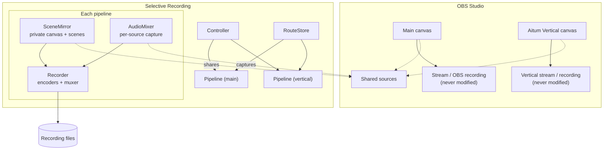
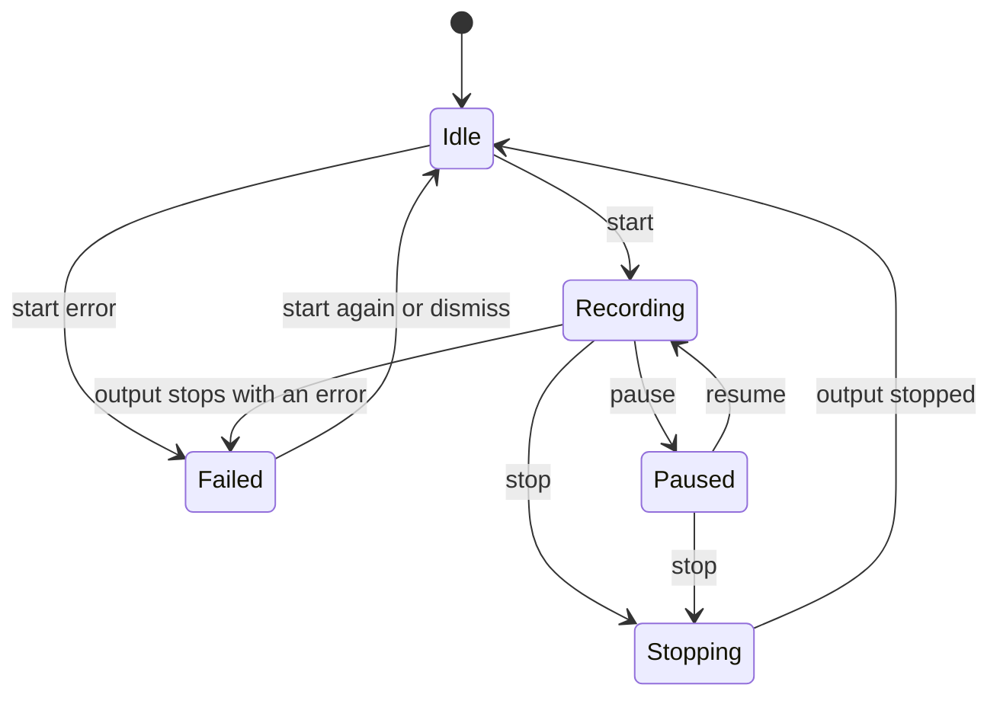
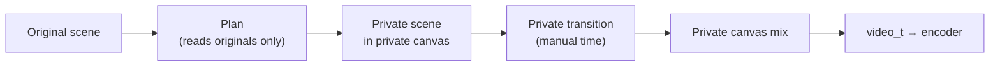

# Architecture

This document describes how OBS Selective Recording works internally. For *what* the plugin does, see the [specification](SPECIFICATION.md). Design decisions and their reasons are in the [ADRs](adr/).

## Overview

For each canvas, the plugin builds a **second, private composition**. It reuses OBS's sources by reference, so nothing is captured twice, and it has its own scenes, video mix, audio mix, encoders and output.

## Ownership boundary

The plugin only *reads* OBS state, and only *writes* to objects it created ([ADR-0003](adr/0003-stream-exclusion.md), NFR-001).

| Object | Access |
| --- | --- |
| Original scenes and scene items, on any canvas | Read: structure, transforms, visibility. Never written. |
| Capture sources | Shared by reference into private scenes. Audio is captured read-only. Never reconfigured. |
| Canvases owned by OBS or other plugins | Read: scenes, channel 0, video info. Signals are observed. |
| Outputs and encoders the plugin didn't create | Read: audio tracks, used only for warnings. Never started, stopped or changed. |
| Private canvas, scenes, groups, transition, audio output, encoders and output | Created, owned and destroyed by the plugin |

The integration tests check this by snapshotting every original scene item before and after recording on each canvas.

## Source layout

| Directory | Contents |
| --- | --- |
| `src/plugin/` | Module entry point. Creates the controller, dock and websocket vendor. |
| `src/core/` | `Controller`, `Pipeline`, `RouteStore`, `Settings`, live-state warnings, OBS helpers |
| `src/video/` | `SceneMirror` |
| `src/audio/` | `AudioMixer` |
| `src/recording/` | `Recorder`, encoder discovery and presets, recovery markers |
| `src/ui/` | Dock, canvas tabs, route buttons, preview, settings dialog |
| `src/api/` | obs-websocket vendor requests |
| `third-party/` | Vendored `obs-websocket-api.h` |

## Controller

`Controller` is a singleton on the UI thread. It:

- Discovers canvases: the main canvas plus every frontend canvas with video. It does this on `FINISHED_LOADING`, `CANVAS_ADDED`, `CANVAS_REMOVED`, collection changes and every two seconds, because Vertical recreates its canvas on a collection switch without a frontend event.
- Owns one `Pipeline` for each canvas, and stops a pipeline cleanly when its canvas disappears.
- Loads and saves routes through the scene collection ([ADR-0007](adr/0007-routes-in-scene-collection.md)), and settings and hotkeys in the plugin config folder.
- Runs a 250 ms tick. Each tick reconciles pipelines and updates stats. Warnings are recalculated every second.
- Registers hotkeys for each canvas (start/stop, pause) and one global start/stop.
- Shuts down at `OBS_FRONTEND_EVENT_SCRIPTING_SHUTDOWN`. OBS clears all scenes immediately after that event and waits for every reference to be released, so recordings stop and mirrors are destroyed there, not at `EXIT`.

## Pipeline

A `Pipeline` belongs to one canvas and owns everything it uses, so failures stay inside it (NFR-002, NFR-003):

- The `SceneMirror` and `AudioMixer` exist only while a recording or preview is running.
- If a hardware encoder fails to start, or fails within five seconds of starting (usually because it ran out of sessions), the pipeline retries once with x264, unless that's turned off (NFR-007).
- Output stop codes become clear messages, such as disk full, encoder failure or unsupported format.
- A recovery marker is written when a recording starts and removed when it stops cleanly (FR-009).

## Video: the scene mirror

`SceneMirror` renders through a private canvas ([ADR-0006](adr/0006-private-canvas-rendering.md)):

- **Base resolution:** the source canvas's base resolution.
- **Output resolution:** the recording resolution.
- **Flags:** `ACTIVATE | EPHEMERAL`. There's no `MIX_AUDIO`, so nothing reaches OBS's tracks.

**Building.** Every scene on the canvas is mirrored when the pipeline starts.
- **Nested scenes** point to their own mirror, so routes apply inside them.
- **Groups** are rebuilt as private `group` sources. Group resizing is deferred until all children are added.
- **Item properties copied:** transform (absolute, via `get_info2`/`set_info2`), crop, scale filter, blending method and blending mode.
- **Locking:** a rebuild reads the original tree first and only then locks the mirror with `obs_scene_atomic_update`. The lock order is always original → mirror.

**Visibility of each mirrored item:**

| Route | Mirrored item |
| --- | --- |
| Both | Follows the original's visibility |
| Recording only | Always visible |
| Stream only, Off | Always hidden |
| Plugin disabled | Follows the original's visibility |

**Keeping in sync:**

| Signal | Handling |
| --- | --- |
| `item_transform` (scenes and groups) | Copied immediately on the emitting thread, so animated transforms stay frame-accurate. `set_info2` takes no scene locks. |
| `item_add`, `item_remove`, `reorder`, `refresh` | The owning scene is marked for a rebuild on the UI thread |
| `item_visible` | Visibility re-evaluated on the UI thread |
| Canvas `source_add` / `source_remove` | Mirrors added or dropped |
| Global `source_remove` | Every mirror that uses the source is rebuilt, so deleted sources are released immediately |

**Transitions.** A graphics-thread tick reads channel 0 of the original canvas:
- If it holds a transition, the private transition is started in manual mode between the mirrored A and B scenes. Its progress is copied from `obs_transition_get_time()` every frame. This covers fades, stingers, Vertical's per-scene overrides and the Studio Mode T-bar.
- Studio Mode's *Duplicate Scene* puts a private copy of a scene on air. The tick maps it to the mirror of the scene with the same name straight away. Within 250 ms the copy gets its own mirror, which is released once it leaves the air.

## Audio: the mixer

`AudioMixer` builds the recording audio from individual sources ([ADR-0004](adr/0004-independent-audio-mix.md)).

1. **Candidates.** Each tick works out which sources can contribute: global audio devices, sources on air in the original program, and sources on air in the mirror.
2. **Inclusion.** Audio follows video ([ADR-0010](adr/0010-audio-follows-video.md)). A source is included while it's active in the mirror, meaning one of its placements is visible in the recording. An audio device isn't in any scene, so it's included when its own route is Both or Recording only.
3. **Capture.** Each included source gets a capture callback. The callback re-applies libobs's timestamp rules and sync offset, then writes the audio into a three-second ring buffer at its timestamp. Muted audio is written as silence.
4. **Mixing.** The `audio_t` callback mixes one 1,024-frame window at a time. Each source is scaled by its OBS fader and its recording gain, and a soft limiter keeps peaks below full scale.
5. **Buffering.** The output window trails real time by a buffer that starts at 64 ms. When a source arrives late, the buffer grows by skipping a block, exactly as libobs does.

## Recording

`Recorder` creates its own video encoder, audio encoder and output:
- **MKV and MOV** use `ffmpeg_muxer`.
- **MP4** uses OBS's crash-resilient `mp4_output` where it's available.

The output's `stop` signal reports the outcome. The callback is copied before it runs, because the owner may destroy the recorder from inside it.

Encoder presets:

| Encoder | Constant quality | Constant bitrate |
| --- | --- | --- |
| x264 | CRF, veryfast | CBR |
| NVENC | CQP, p5 | CBR |
| AMF, QuickSync | CQP | CBR |

## Sources-list buttons

`SourceListButtons` adds a button to each row of OBS's own Sources list (`QListView` named `sources`, class `SourceTree`). There's no public API for this. To stay safe:
- Every 400 ms, and after every scene change, it rebuilds the list's order using OBS's rule: top item first, with expanded group children under their group.
- It only touches a row when the row count matches and the row's label shows that source's name.
- It inserts a `QToolButton` into the row's layout, before the visibility checkbox. OBS recreates rows often, so missing buttons are simply added again.
- A button stores only the scene UUID and item ID, and resolves the item when clicked.
- If OBS's list changes in a future version, the buttons stop appearing and nothing else breaks.

A click goes through `core/placement` ([ADR-0008](adr/0008-streamlabs-style-placements.md)), which is shared with the dock's simple view and `SetItemRoute`:
- It sets the placement's video as an item override, kept only where it differs from what the source inherits.
- For Recording only it also hides the scene item, marking it in the item's private settings, and it shows the item again later only if that mark is there.
- Each placement with a route carries its key in its scene item's private settings. libobs copies private settings into Studio Mode's duplicate, so the copy OBS puts on air finds the original's route without the plugin searching scenes (an earlier position-matching approach enumerated scenes that OBS could be destroying, and crashed).

Other canvases' Sources lists get the same buttons. Aitum Vertical's "Vertical Sources" dock uses its own copy of OBS's `SourceTree` class with the same row layout and order, but the plugin can't ask it which scene it shows. So every 2 s it looks for `SourceTree` views other than `sources`, and identifies each one by its rows: it tries every extra canvas's on-air scene (both sides of a running transition), then the canvas's other scenes, and uses the first whose items match the rows. Those buttons store their canvas key, so the route is read and set on that canvas.

## Record button

`RecordButtonTakeover` makes OBS's Record button (`recordButton` in the Controls dock) start and stop the selective recordings ([ADR-0009](adr/0009-record-button.md)):
- It installs an event filter on the button and swallows its mouse and keyboard activation, so OBS's own `RecordButtonClicked` never runs and OBS's recording output is never started.
- A click toggles every enabled canvas (`Controller::toggle_all`), and the button's text and checked state follow the selective recordings, re-applied every 300 ms.
- While OBS's own recording is active (its hotkey, obs-websocket), events pass through so OBS can stop it, and the plugin leaves the button to OBS.
- The setting `record_button` turns it off; the button is then restored to OBS's own state.

## Folders

Folders (groups) have no route of their own ([ADR-0008](adr/0008-streamlabs-style-placements.md)). `RouteStore::resolve_video` returns Both for a group source or group item, so a folder always follows its eye. Folder routes saved by earlier versions are dropped in `remove_missing_sources`, and a folder the plugin had hidden is shown again. With `folder_buttons` on, a folder's button calls `set_folder_route`, which sets every unlocked source inside in one change.

## Warnings

`evaluate_warnings()` reads OBS state and changes nothing:
- **Video:** it walks the scene on air on each canvas and flags visible items whose route is Recording only or Off.
- **Audio:** it compares each source's mixer flags with the tracks used by that canvas's stream. On the main canvas it reads the streaming output, or the profile settings if there isn't one. On other canvases it looks for outputs whose video encoder reads that canvas.
- **Shared tracks:** if removing a source from a track would also remove it from another canvas's stream that should keep it, the dock explains that conflict (NFR-006).

## Threading

| Thread | What runs there |
| --- | --- |
| UI (Qt main) | Controller, pipelines, routes, mirror rebuilds, dock |
| Graphics | Transition tick, preview drawing |
| Scene signal threads | Transform copies (no locks other than the link map) |
| Source audio threads | Capture callbacks (short per-source lock) |
| Recording audio thread | Mixing |
| Output threads | Stop callbacks, which post to the UI thread |
| obs-websocket | Vendor requests, which run synchronously on the UI thread |

Signal handlers hand work to the UI thread together with a weak "alive" token. Work posted after an object is destroyed is dropped.

## Reference ownership

- Every OBS object the plugin holds uses the RAII wrappers in `obs.hpp`.
- Private scenes are removed from the private canvas before they're released.
- **The private canvas outlives its scenes.** A scene made in a canvas keeps a pointer to the canvas's lock even after it's removed from the canvas, and libobs destroys released scenes later on its task thread. So `~SceneMirror` releases the scenes, waits for libobs's destroy queue (`obs_wait_for_destroy_queue`), and only then releases the canvas. Releasing the canvas first caused an intermittent crash in `obs_source_destroy_defer`. If a scene is somehow still alive after the wait, the canvas is deliberately leaked rather than freed under it.
- The preview holds its canvas reference under a mutex while it draws, so the last release always happens on the UI thread.
- Integration tests check that OBS reports `Number of memory leaks: 0` after a long session that ends with recordings still running.

## Portability

Engine code uses only libobs and the frontend API. Qt appears in the engine only to post work to the UI thread. The CI workflows (currently disabled) compile on Windows, macOS and Ubuntu; the Docker build covers Windows. Runtime testing has been done on Windows only.
