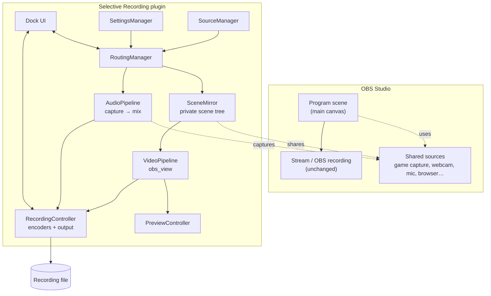
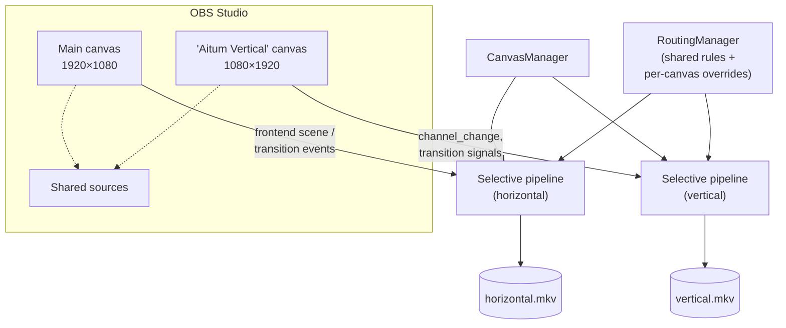
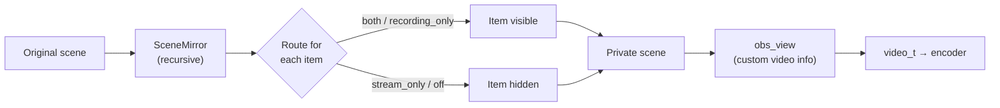
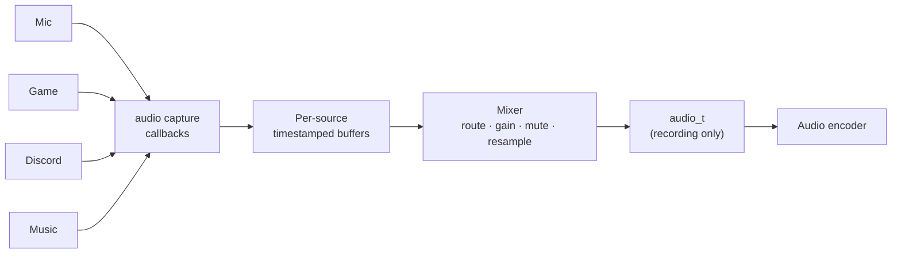
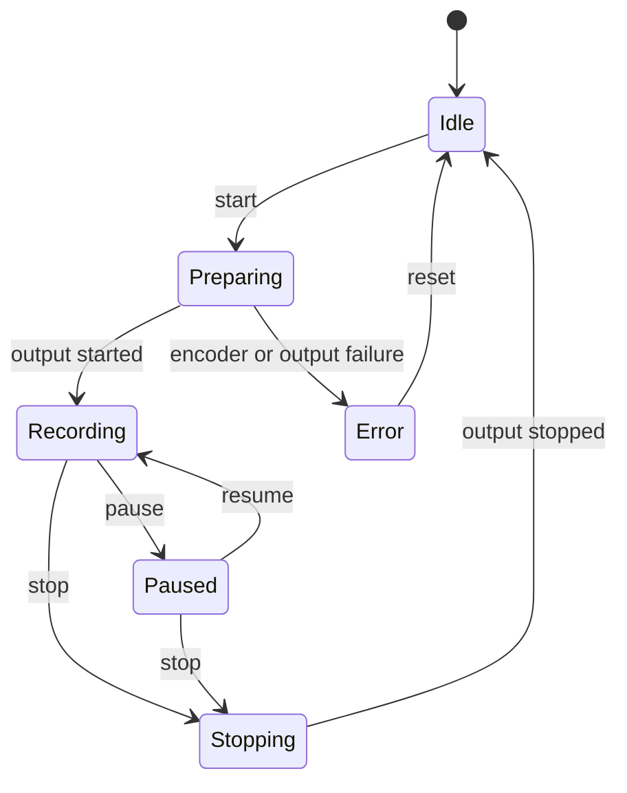

# Architecture

This document describes how OBS Selective Recording works internally. For *what* the plugin does, see the [specification](SPECIFICATION.md).

> Parts of this design depend on the proofs of concept in the [roadmap](ROADMAP.md#proofs-of-concept). Anything marked **(POC)** may change based on what they show.

## Overview

The plugin builds a **second, private composition** alongside OBS's own. That composition reuses OBS's capture sources by reference, so nothing is captured twice. It has its own scene containers, video mix, audio mix and encoders.

## Multiple canvases

The diagram above shows one canvas. In practice the plugin runs **one selective pipeline per canvas**, so the main horizontal canvas and a vertical canvas from [Aitum Vertical Canvas](https://github.com/Aitum/obs-vertical-canvas) each get their own. See [ADR-0005](adr/0005-multi-canvas-support.md).

Each *selective pipeline* is a `SceneMirror`, `VideoPipeline`, `AudioPipeline` and `RecordingController`, all bound to one canvas. Pipelines share the `RoutingManager` and `SettingsManager`, and never share private scenes or encoders.

| Canvas event | Source | Action |
| --- | --- | --- |
| `FINISHED_LOADING`, `CANVAS_ADDED` | frontend | Discover canvases and create a pipeline for each enabled one |
| `CANVAS_REMOVED`, canvas `remove` | frontend, canvas | Stop that pipeline's recording cleanly, then tear it down |
| `channel_change` (channel 0) | canvas | Switch the private program scene, or attach to the new transition |
| `transition_start` / `transition_stop` | the canvas's transition source | Drive the private transition |
| `source_add` / `source_remove` | canvas | Add or remove mirrored scenes |
| `video_reset` | canvas | Update the default recording resolution, applied on the next start |

The main canvas is followed through frontend events (`SCENE_CHANGED`, `TRANSITION_*`), because OBS's own transition lives outside the canvas channel.

## Components

Each component owns its own state and exposes a small interface. Components never reach into each other's internals.

| Component | Directory | Responsibility |
| --- | --- | --- |
| `CanvasManager` | `src/core/` | Discovers canvases, tracks additions and removals, and owns one selective pipeline per enabled canvas. |
| `SourceManager` | `src/core/` | Enumerates scenes (for each canvas), groups, items and audio sources. Emits change events. |
| `RoutingManager` | `src/core/` | Resolves the effective video and audio route for any source or item. |
| `SettingsManager` | `src/core/` | Loads, saves and migrates configuration. |
| `SceneMirror` | `src/video/` | Builds and maintains the private scene tree from the original scenes. |
| `VideoPipeline` | `src/video/` | Renders the private program scene into an independent `obs_view` mix. |
| `PreviewController` | `src/video/` | Draws the recording mix in the dock. Disabled while hidden. |
| `AudioPipeline` | `src/audio/` | Captures each source's audio, applies routing and gain, and mixes the result. |
| `RecordingController` | `src/recording/` | Runs the output lifecycle: start, pause, stop and error handling. |
| `EncoderManager` | `src/recording/` | Discovers available encoders and builds encoder settings. |
| `DockController` | `src/ui/` | Qt dock connecting user actions to the engine. |
| `HotkeyManager` | `src/ui/` | Registers and persists plugin hotkeys. |

Directories are created as each milestone begins, not before.

## Video pipeline

**Private scene tree.** For each original scene on the pipeline's canvas, the mirror creates a private scene with `obs_scene_create_private`. It adds the *same* `obs_source_t` objects as items, and copies each item's transform, crop, blend mode, order and visibility. Nested scenes and groups are mirrored recursively, so a nested scene item points to the mirrored child scene instead of the original. A nested scene can belong to a different canvas, for example a horizontal scene used inside a vertical one, so the mirror resolves the child from whichever canvas owns it. See [ADR-0002](adr/0002-private-scene-mirror.md).

**Rendering.** `obs_view_add2()` adds the private program scene to the render loop with its own `obs_video_info`, which allows a different resolution or frame rate from the canvas. It returns a `video_t` that the video encoder connects to. See [ADR-0001](adr/0001-obs-view-over-canvas-api.md).

**Synchronisation.** The mirror listens to these signals instead of polling:

| Signal | Source | Mirror action |
| --- | --- | --- |
| `item_add`, `item_remove` | scene | Add or remove the mirrored item |
| `reorder`, `refresh` | scene | Re-sync item order |
| `item_transform` | scene | Copy the transform |
| `item_visible` | scene | Re-evaluate the route and visibility |
| `rename` | source | Update the inventory |
| `remove`, `destroy` | source | Release mirrored references |
| `SCENE_CHANGED` | frontend | Switch the private program scene |
| `SCENE_COLLECTION_CHANGING` / `CHANGED` | frontend | Tear down, then rebuild |
| `TRANSITION_*` | frontend | Drive the private transition |

**Transitions (POC).** The view renders a private transition source whose type and duration match the active OBS transition. Its endpoints are the mirrored scenes. Hard cuts come first. In Studio Mode, the mirror follows the program scene only.

## Audio pipeline

- `obs_source_add_audio_capture_callback()` delivers each source's audio and its mute state on the audio thread.
- Each source writes into its own ring buffer, keyed by timestamp. The mixer pulls an aligned window from every routed source, rather than mixing samples as callbacks happen to arrive.
- The mixed result goes to a plugin-owned `audio_t`, so OBS's track mixer and live audio stay untouched.
- **(POC)** It hasn't been confirmed which OBS mixer stages (volume, balance, sync offset, push-to-talk, filters) are already applied when the callback runs. The plugin must match OBS for any stage that isn't. See [ADR-0004](adr/0004-independent-audio-mix.md).

## Recording engine

For each canvas, the plugin creates its own `ffmpeg_muxer` output and its own video and audio encoders. It connects them to that pipeline's private `video_t` and `audio_t`. OBS's own outputs are never touched, and neither are another plugin's outputs, such as Vertical's stream, recording and replay buffer.

Before starting, the controller checks that the chosen encoder can open another session. With dual streaming plus two selective recordings, hardware encoder session limits can be reached. If that happens, recording fails with a clear message, and the live streams are left untouched.

## Threading

| Thread | What runs there |
| --- | --- |
| UI (Qt main) | Dock, frontend events and settings |
| Graphics | `obs_view` rendering and preview drawing |
| Audio | Capture callbacks. These must not block or allocate in the hot path. |
| Output | Encoder and muxer callbacks |

Scene and source signals can fire from any thread. Handlers only collect changes and send them to the UI thread, which owns the mirror state.

## Reference ownership

- Every `obs_source_t`, `obs_scene_t` and `obs_sceneitem_t` the plugin holds uses the RAII wrappers from `obs.hpp` (`OBSSourceAutoRelease` and similar). Raw pointers are borrowed only for the duration of a call.
- When a source is removed (`remove` signal), the plugin drops every mirrored reference to it immediately, so OBS can destroy the source even while a recording is running.
- On `OBS_FRONTEND_EVENT_EXIT`, the plugin stops the output, tears down the mirror and removes every callback, all before `obs_module_unload` runs.

## Portability

The engine (`core/`, `video/`, `audio/` and `recording/`) uses only libobs APIs. Qt is confined to `ui/`, and Windows-specific code isn't allowed outside `utilities/`. This keeps future Linux and macOS ports to packaging work rather than engine changes.
