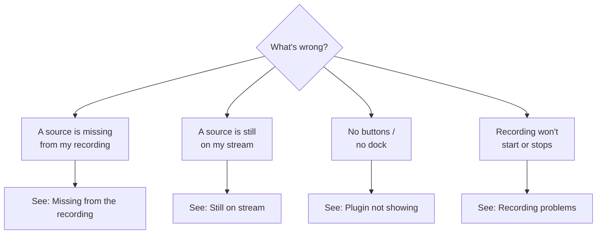

# Troubleshooting

Find your problem below. If it's not here, [open an issue](../../../issues/new/choose) with your OBS log (**Help → Log Files → Upload Current Log File**).



## Missing from the recording

**A Recording only source isn't in my recording.**
1. **Did you record with Selective Recording?** OBS's **Start Recording button** does (unless you turned that off in Settings), and so does the dock. OBS's Start Recording **hotkey** makes OBS's *normal* recording, which shows only what's live, so Recording only sources aren't in it.
2. **Is it inside a folder whose eye 👁 is off?** A hidden folder hides everything in it, on stream and in the recording.
3. **Is the canvas allowed?** Check **Settings → (canvas) → Allow selective recording**.

**A source's sound is missing.**
- In the dock's **Advanced** view, its **Audio** button must be *Stream and recording* or *Recording only*.
- The source must be in the scene that's recording, or be a global device (Desktop Audio, Mic).
- The recording follows OBS's volume fader, so check it isn't down.

## Still on stream

**I set a source to Recording only but it's still on stream.**
- **Set with a button:** the button turns the source's eye off. If it's back on stream, the eye was turned on again. Click the button to *Recording only* again.
- **Set in the dock's Advanced view:** Advanced settings never change OBS. Turn the source's eye off yourself, and for sound, untick the stream's track in **Edit → Advanced Audio Properties**. The ⚠ in the dock shows what's still live.

## Plugin not showing

**No dock.** Open **Docks → Selective Recording**. If it's not listed, the plugin didn't load. In the log (**Help → Log Files → View Current Log**), look for:

```
[obs-selective-recording] loaded (version 1.0.0)
```

If it's missing, check that:
- the files are in `C:\ProgramData\obs-studio\plugins\obs-selective-recording\` (or OBS's own `obs-plugins` folder for a portable OBS);
- your OBS is **31.1 or newer**;
- the plugin isn't turned off in **Tools → Plugin Manager** (OBS 32+).

**No buttons in the Sources list.** Turn on **Settings → Interface → Show recording buttons in OBS's Sources list**. Folders don't have buttons unless you turn on folder buttons there too.

**No Aitum Vertical tab.** You need Vertical Canvas **1.6 or newer**. The tab appears a couple of seconds after Vertical's canvas does.

## Recording problems

| Message or symptom | Fix |
| --- | --- |
| "The video encoder stopped working" / hardware encoder fails | Your graphics card has a limit on encodes at once, and streams count. Keep **Fall back to x264** on, or pick x264 for one canvas. |
| "Couldn't create the recording folder" | Choose a folder that exists in **Settings → (canvas) → Recording folder**. |
| "There isn't enough free disk space" | Free up space. Recording won't start with less than 200 MB free. |
| Audio and video out of sync | It uses OBS's own timing and each source's **Sync Offset**. If OBS's normal recording is in sync and this isn't, please report it. |
| OBS crashed while recording | The dock lists the files next time. MKV files play as they are; **File → Remux Recordings** converts them to MP4. |

## Harmless log messages

`Attempted to add Scene without specifying a canvas!` appears on OBS 33 when a recording or preview starts. It's normal: OBS logs it whenever a plugin creates its own private scene.

## Reporting a bug

[Open a bug report](../../../issues/new/choose) with:
- your OBS version, plugin version and Aitum Vertical version (if any);
- a log from **Help → Log Files → Upload Current Log File**;
- what you expected, and what happened.
