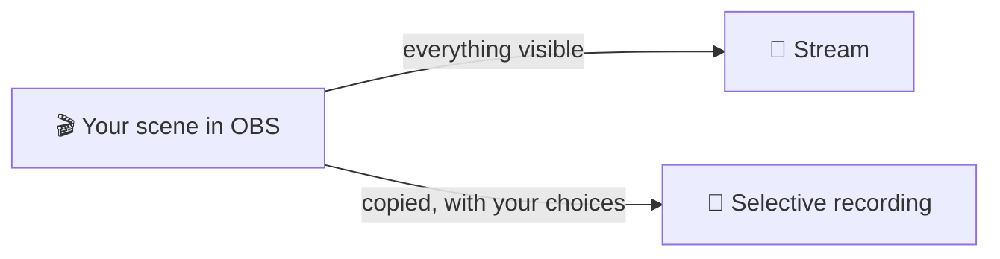
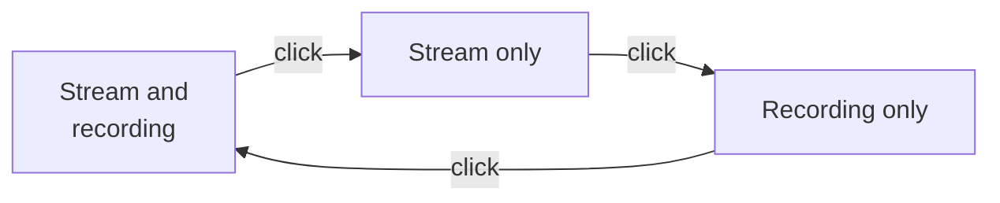
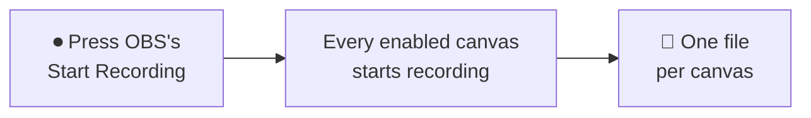
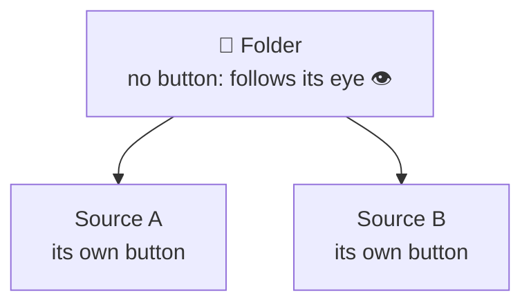

# User Guide

Everything Selective Recording does, step by step. New here? Start with **[The basics](#the-basics)**.

- [The basics](#the-basics)
- [The buttons](#the-buttons)
- [Recording](#recording)
- [Folders](#folders)
- [The dock](#the-dock)
- [Audio](#audio)
- [Warnings](#warnings-)
- [Settings](#settings)
- [Hotkeys](#hotkeys)
- [After a crash](#after-a-crash)

## The basics

Your stream and your recording don't have to show the same thing. Selective Recording keeps **its own copy of your scenes** and records that copy. Your stream is what OBS shows; your recording is what you choose.

## The buttons

Every source in OBS's **Sources** list has a button next to its eye 👁. With Aitum Vertical, the **Vertical Sources** dock has them too.

| | Setting | Stream | Recording |
| :---: | --- | :---: | :---: |
|  | **Stream and recording** | ✅ | ✅ |
|  | **Stream only** | ✅ | ❌ |
|  | **Recording only** | ❌ | ✅ |

- **Click** to cycle. **Right-click** to pick a setting, open the dock, or hide the buttons.
- Each button sets **this source in this scene**. The same source in another scene can be set differently.
- **Recording only** turns the source's eye off, so it leaves your stream, and keeps it in your recording. Click back to *Stream and recording* and the eye turns on again. If you had turned the eye off yourself first, it stays off.
- A **locked** source's button is greyed out. Unlock it in OBS to change it.
- A grey  means the source is set to **Off** in the dock's **All scenes** view. Click to set it back.

> **Why does Recording only turn the eye off?** Streamlabs uses its own modified OBS that can show a source on one output only. Standard OBS can't, so the plugin hides it from your stream and adds it back in its own recording copy.

## Recording

- **OBS's Start Recording button** makes your selective recording, like Streamlabs. It records every canvas you've enabled (main, and Aitum Vertical if you have it). Press it again to stop.
- **The dock** can also start and stop each canvas on its own, and pause or resume.
- OBS's **Start Recording hotkey** and automation tools still make OBS's *normal* recording, which shows only what's live. To use the hotkey for selective recording, set *Start/stop all selective recordings* under [Hotkeys](#hotkeys).
- Don't want the Record button taken over? Turn off **Settings → Interface → OBS's Record button records with Selective Recording**.

Files go to OBS's recording folder unless you choose another in Settings. Vertical recordings end in " Aitum Vertical".

## Folders

Folders (OBS groups) work like in Streamlabs:

- A folder has **no button**. It just follows its eye: if the folder's eye is off, nothing inside it is on stream *or* in the recording.
- Set **the sources inside** the folder one by one.
- **Want one click for the whole folder?** Turn on **Settings → Interface → Give folders a button that sets every source inside**. The folder's button then sets all its sources at once, and shows an amber dot when they're set differently.

## The dock

The **Selective Recording** dock opens the first time OBS starts with the plugin. Reopen it any time from **Docks → Selective Recording**.

| Part | What it does |
| --- | --- |
| **Enabled** | Untick to record everything exactly as it's live |
| **Profile** | Saved sets of choices (**⋯** to add, rename, import, export) |
| **Settings** | Recording and interface options (see [Settings](#settings)) |
| **Tabs** | One per canvas: **Main** and **Aitum Vertical** |
| **Current scene** (normal view) | The scene on air, with the same buttons as the Sources list |
| **All scenes** button | Every scene, plus your mic and desktop audio, with **Off**, per-canvas settings and recording volume. Click it again to go back |
| **Preview** | Shows exactly what's being recorded |

<b>All scenes view in detail</b>

- **Click** a source's button to cycle Both → Stream only → Recording only → Off. It sets the source's video and sound together.
- **Right-click** for:
  - **Every canvas** (normal)
  - **Only on this canvas**, for example to leave a webcam out of the vertical recording only
  - **Only this placement**, when the same source is in several scenes
  - **Recording volume…** (sources with sound)
  - **Reset to default**
- *Italic* means the profile default. A **•** marks a setting for one canvas or one placement.
- Select several rows and right-click to change them all.
- Search and filter: *Left out of recording*, *Recording only*, *Has warnings*.
- **Recording only** works as it does with the Sources-list buttons: the source is hidden in OBS so it leaves the stream, and shown again when you set it to *Both* or *Stream only*, even if you click through *Off* on the way.
- **Off** leaves the source out of the recording and doesn't change your stream. Hide it in OBS yourself if you want it off the stream too; the dock warns you until you do.

## Audio

A source's **sound goes with its video.** Set Game Capture to **Stream only**, and both its picture and its game audio stay out of the recording.

| You want | Do this |
| --- | --- |
| Music on stream, not in the recording | Set the music source to **Stream only** |
| A sound only in the recording | Set the source to **Recording only**. It's hidden in OBS, which mutes it on stream, and the recording keeps its sound |
| Your mic or desktop audio left out of the recording | Dock → **All scenes** → **Audio devices**, set it to **Stream only** |
| Louder or quieter in the recording only | Dock → **All scenes**, right-click the source → **Recording volume…** |

Mic and desktop audio set up in **Settings → Audio** aren't in any scene, so they have their own button under **Audio devices** in the All scenes view. If you set one to **Recording only**, untick it from the stream's track in **Edit → Advanced Audio Properties**; the dock warns you until you do.

## Warnings ⚠

A ⚠ in the dock means something you wanted off the stream is still reaching it:

- **Still visible live:** turn its eye off in OBS (the button does this for you).
- **Still on the stream's audio track:** open **Edit → Advanced Audio Properties** and untick the stream's track.
- **Shared track:** your horizontal and vertical streams use the same audio track, so you can't remove a source from just one. Give each stream its own track.

Hover the ⚠ for exactly what to change.

## Settings

Open with the **Settings** button in the dock.

| Tab | Options |
| --- | --- |
| **General** | Container (MKV recommended; remux later with **File → Remux Recordings**), audio encoder and bitrate, filename format, fall back to x264 if a hardware encoder fails, warnings, crash recovery, and **Interface**: Sources-list buttons, folder buttons, OBS's Record button |
| **One per canvas** | Allow selective recording, resolution, frame rate (full, ½, ⅓ or ¼), encoder (Automatic picks NVENC, AMD or QuickSync, else x264), quality or bitrate, folder, filename suffix |

Changes apply to the next recording.

## Hotkeys

In OBS's **Settings → Hotkeys**, search for "selective":

- **Start/stop selective recording** (one per canvas)
- **Pause/resume selective recording** (one per canvas)
- **Start/stop all selective recordings**

## After a crash

If OBS stops unexpectedly while recording, the dock lists the interrupted files the next time it starts. MKV files play as they are. **Show files** opens the folder; **Dismiss** clears the notice.

---

Stream Deck or scripts? See the [automation API](API.md). Something not working? See [Troubleshooting](TROUBLESHOOTING.md).
